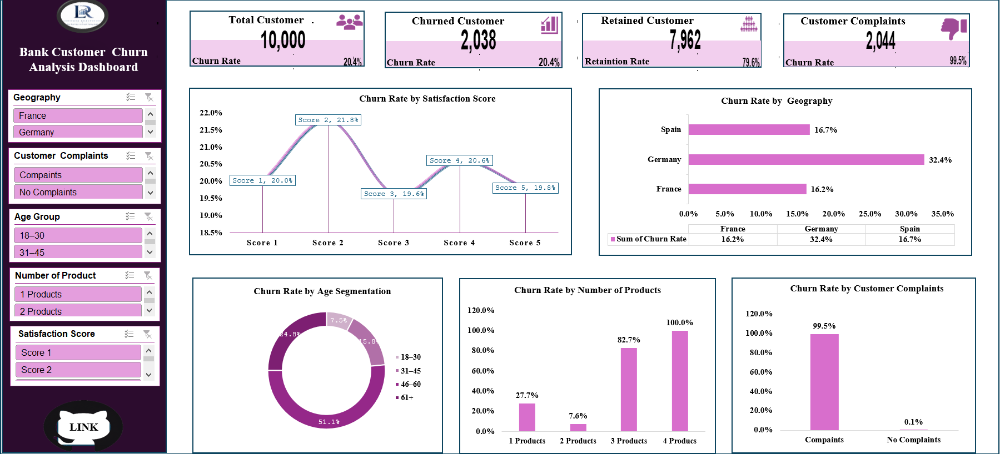

# Which customer segments account for a bank's 20.4% attrition, and where should a retention budget be spent first?



*Interactive Excel dashboard built on pivot tables, pivot charts and slicers. Open [`workbook/Bank_Customer_Churn_Dashboard.xlsx`](assets/Excel_WorkBook1.xlsx) to filter by geography, age group and complaint status.*

---

## Executive Summary

Of **10,000 customers, 2,038 churned (20.4%)** and 7,962 were retained (79.6%). Churn is not evenly spread. A handful of segments carry a disproportionate share of the losses:

| Segment | Churn rate | Share of customer base | Share of all churners |
|---|---|---|---|
| Germany | 32.4% | 25.1% | 39.9% |
| Age 46–60 | 51.1% | 16.5% | 41.3% |
| 3–4 products | 85.9% (82.7% and 100%) | 3.3% | 13.7% |
| Filed a complaint | 99.5% | 20.4% | 99.8% |

Three things stand out:

1. **Geography and life stage matter.** Germany churns at roughly twice the rate of France (16.2%) and Spain (16.7%). Customers aged 46–60 churn at 3.2x the rate of the 31–45 group (51.1% vs 15.8%).
2. **Product depth is non-linear.** Two-product customers are the most stable segment (7.6% churn), while single-product customers churn at 27.7% and the small 3–4 product group at 82.7–100%. More products is not automatically better retention.
3. **Satisfaction score has almost no discriminating power.** Churn ranges only from 19.6% to 21.8% across scores 1–5, against a 20.4% baseline. Customers scoring 5 churn at 19.8%, essentially the same as those scoring 1 (20.0%).

The complaint result (2,034 of 2,044 complainants churned) is the strongest signal in the data, but it is also the one that needs to be validated before anyone acts on it. See the caveat under Key Findings.

---

## Business Context

Retail banking revenue depends on holding customer relationships over time, and a 20.4% attrition rate means roughly one in five customers in this portfolio was lost. The bank operates across three markets, with France accounting for half of the base (5,014 customers), Germany 2,509 and Spain 2,477.

Retention teams usually have a fixed budget and need to know *which* customers to prioritise and *what* is driving their exit. A blanket retention campaign would spend most of its money on segments that were never at risk: 7,962 customers stayed. This analysis is built to narrow the target.

---

## Objectives

The analysis answers five specific questions:

| # | Question | Short answer |
|---|---|---|
| 1 | Which customer groups are most likely to churn? | Age 46–60 (51.1%), German customers (32.4%), customers with 3+ products (85.9%) |
| 2 | Does satisfaction score predict churn? | No. Range across scores is 2.2 percentage points |
| 3 | Which region has the highest churn? | Germany, 32.4% vs 16.2% in France and 16.7% in Spain |
| 4 | Does product count influence retention? | Yes, but not in a straight line. Best at 2 products (7.6%) |
| 5 | How strongly are complaints associated with churn? | 99.5% churn among complainants vs 0.05% among non-complainants |

A secondary objective was to package the findings in an interactive dashboard so stakeholders can slice the portfolio themselves.

---

## Data Overview

| Item | Detail |
|---|---|
| Source | Kaggle customer churn dataset ([add link]) |
| Grain | One row per customer, 10,000 records |
| Target variable | `Exited` (1 = churned, 0 = retained) |
| Churned / retained | 2,038 / 7,962 |
| Dimensions analysed | Geography (3), gender, age (grouped into 4 bands), number of products (1–4), satisfaction score (1–5), complaint flag |
| Also reviewed | Active-member status, credit card ownership, card tier |

**Age bands** were derived from raw age: 18–30 (1,968 customers), 31–45 (5,921), 46–60 (1,647) and 61+ (464).

**Preparation:** missing values, duplicate customer IDs and field consistency were checked, then age bands and churn percentages were calculated. Full steps are in [`docs/methodology.md`](docs/methodology.md).

**Scope limits worth knowing before reading the findings:**

- Every cut below is a single-variable view. Segments overlap (for example, German customers who also hold three products), so the effects are not additive.
- No significance testing or multivariate modelling has been applied yet. Findings are descriptive associations, not causal claims.
- Small segments (60 customers with four products, 266 with three) produce extreme rates that are less stable than the large segments.

---

## Key Findings

### 1. Customers aged 46–60 are the highest-risk age band
This band churns at **51.1% (842 of 1,647)**, against 15.8% for 31–45, 24.8% for 61+ and 7.5% for 18–30. It represents 16.5% of customers but 41.3% of all churners. The 31–45 band is the largest source of churners by volume (933, or 45.8%), but at a much lower rate.

### 2. Germany churns at about twice the rate of France and Spain
Germany loses **32.4% (814 of 2,509)** of its customers versus 16.2% in France (811 of 5,014) and 16.7% in Spain (413 of 2,477). Germany holds a quarter of the customer base but produces 39.9% of churners, roughly the same absolute loss as France with half the customers.

### 3. Product count has a U-shaped relationship with churn
| Products held | Customers | Churned | Churn rate |
|---|---|---|---|
| 1 | 5,084 | 1,409 | 27.7% |
| 2 | 4,590 | 349 | 7.6% |
| 3 | 266 | 220 | 82.7% |
| 4 | 60 | 60 | 100.0% |

Single-product customers are the largest loss pool (69.1% of churners). Customers with three or more products are only 3.3% of the base, yet 280 of the 326 left (85.9%). Every customer with four products churned, which points to a product, pricing or service-fit problem rather than a loyalty effect.

### 4. Satisfaction score does not separate churners from stayers
| Score | 1 | 2 | 3 | 4 | 5 |
|---|---|---|---|---|---|
| Churn rate | 20.0% | 21.8% | 19.6% | 20.6% | 19.8% |

The spread is 2.2 percentage points and the pattern is non-monotonic. A satisfaction survey alone would not have flagged this attrition.

### 5. Complaint status is almost perfectly aligned with churn, and needs validating
**2,034 of 2,044 complainants churned (99.5%)**, while only 4 of 7,956 customers without a complaint did (0.05%). Complainants account for 99.8% of all churn.

> **Caveat.** A relationship this close to deterministic usually indicates that the complaint flag was recorded at or after the exit event (target leakage) rather than before it. If so, it describes churn instead of predicting it. Before building any action on this field, confirm from the source system whether complaint dates precede the exit date.

### 6. Secondary signals (from the pivot analysis sheet)
- **Gender:** female customers churn at 25.1% (1,139 of 4,543) vs 16.5% for male customers (899 of 5,457), a 1.5x gap.
- **Activity:** non-active members churn at 26.9% vs 14.3% for active members.
- **Card tier and credit card ownership:** no meaningful separation (card tiers 19.3–21.8%; with card 20.2% vs without 20.8%).

---

## Recommendations

| Priority | Action | Target | Evidence | Success metric |
|---|---|---|---|---|
| 1 | **Validate the complaint field, then build a complaint-resolution workflow.** Confirm timestamps; if complaints precede exit, add a priority triage and follow-up SLA | 2,044 complainants | 99.5% churn; 99.8% of churners had a complaint | Complaint-to-churn conversion, time to resolution |
| 2 | **Run a root-cause review in Germany.** Compare pricing, service quality, product terms and competitor offers against France and Spain | 2,509 German customers | 32.4% churn, 39.9% of all churn | German churn rate vs the 16–17% seen elsewhere |
| 3 | **Launch a targeted retention programme for ages 46–60**, starting with qualitative research to find out why this band leaves | 1,647 customers | 51.1% churn, 41.3% of all churn | Churn rate of the band, tracked by cohort |
| 4 | **Audit the 3–4 product holders before any further cross-selling.** Investigate bundling, fees and service issues for this group | 326 customers | 85.9% churn | Churn rate at 3+ products |
| 5 | **Move single-product customers toward a second product through a controlled pilot.** Use an A/B design to test whether the 7.6% churn at two products is causal or a selection effect | 5,084 customers | 27.7% vs 7.6% | Churn of treated vs control group |
| 6 | **Replace satisfaction score as the lead indicator with a composite early-warning score** combining age band, country, product count and activity status | Whole base | Satisfaction range of 2.2 pp | Lift of the composite score over baseline 20.4% |

**Sizing the opportunity.** These are theoretical ceilings, not forecasts, and they overlap:

- Bringing Germany to France's rate (16.2%) would avoid about **408 exits (4.1 pp of total churn)**.
- Bringing the 46–60 band to the 31–45 rate (15.8%) would avoid about **582 exits (5.8 pp)**.
- Bringing single-product customers to the two-product rate (7.6%) would avoid about **1,023 exits (10.2 pp)**, which is the least likely to be achievable because it assumes the association is fully causal.

**Next analytical steps:** cross-tabulate segments (country x product count, age x product count), test associations with chi-square or logistic regression, and re-run the complaint analysis once the timing question is answered.

---

## Repository Structure

```
bank-churn-analysis/
├── README.md
├── assets/
│   └── dashboard_overview.png
├── data/
│   └── README.md            # source link, field dictionary, licence
├── workbook/
│   └── Bank_Customer_Churn_Dashboard.xlsx
└── docs/
    ├── methodology.md       # data prep, metric definitions, workbook map, QA log
    └── portfolio_notes.md   # tools, skills, challenges
```
